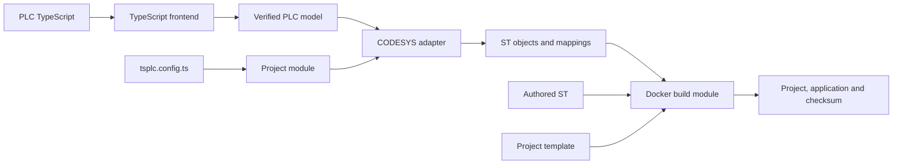

# tsPLC architecture

tsPLC is one Bun workspace. A project supplies one `tsplc.config.ts`; TypeScript PLC source is optional. The CODESYS backend uses the vendor compiler inside Docker.

| Module                    | Responsibility                                                                     | Main interface                                          |
| ------------------------- | ---------------------------------------------------------------------------------- | ------------------------------------------------------- |
| `@tsplc/config`           | Shared configuration, defaults, duration values and path resolution                | `defineConfig`, `loadTsplcConfig`                       |
| `@tsplc/compiler`         | Read PLC TypeScript and produce a typed PLC model                                  | `analyze`                                               |
| `@tsplc/compiler/ir`      | Verify storage, evaluation order, types and finite execution                       | `normalizeModule`                                       |
| `@tsplc/compiler/codesys` | Plan target bindings and emit readable ST objects                                  | `planCodesys`, `emitCodesys`                            |
| `@tsplc/compiler/project` | Check, emit, compile and publish an owned project                                  | `checkProject`, `buildProject`, `cleanProject`          |
| `@tsplc/build`            | Import ST into a project template, compile through Docker and operate a controller | `buildProject`, `updateController`, `inspectController` |
| `@tsplc/typegen`          | Generate TypeScript declarations, hardware bindings and editor metadata            | `generateTypes`, `generateProject`                      |
| VS Code extension         | ST editing, descriptor/IO views, dependency validation and read-only monitoring    | Editor commands and the Hardware & IO view              |

The compiler subpaths are parts of one package. They do not require separate package installations. The shared configuration package owns configuration data; it does not import compiler or build implementations.

## Source to build

The frontend reads a TypeScript Program and checks canonical SDK symbols. It does not execute PLC source. Unsupported JavaScript behavior receives a diagnostic; it cannot silently disappear from the emitted program. The verified model preserves the order of reads, calls, assignments and short-circuit branches. Storage and loop bounds remain finite.

The CODESYS adapter owns physical addresses, IEC names, scan input/output handling and generated task calls. Source folders are reflected in ST folders. Source record and enum names are retained so generated declarations and existing public interfaces agree. Valid authored names remain recognizable; reserved names and collisions receive safe names. Diagnostic mappings and generated IO symbol metadata record the resulting names. The editor consumes those mappings instead of reconstructing names independently.

The project template supplies the controller, runtime settings, fieldbus topology and installed device descriptions. An EDS file describes hardware layout; it does not commission a fieldbus connection by itself. Configured assembly selections and offsets resolve named IO channels to physical addresses. Direction, scalar type, width, address profile and overlapping storage are checked before use.

Only one target adapter is implemented. Backend-independent PLC semantics stay in the frontend and verified model. A second backend can implement target planning and emission at that existing seam; there is no speculative backend registry or dialect framework.

## Generated files and ownership

Compiler output lives under `.tsplc/artifacts`. Generated ST, source mappings and IO symbol metadata are published together. A receipt distinguishes ST emission from successful vendor compilation. Compilation happens in a staging directory; failure cannot publish a partial bundle or leave a success receipt for changed source.

Ownership checks protect manually edited or unrelated files. Clean removes compiler-owned artifacts and leaves the engineering cache outside that ownership. These checks are part of the project module's interface, not optional cleanup conventions.

The configured `build.outDir` contains vendor artifacts and the engineering cache. Controller operations maintain the compiler's online-change baseline there. An online change requires the appropriate existing baseline and never silently becomes a full download. Inspection reads controller state without emitting PLC source.

## Type generation and the editor

Typegen reads ST declarations and hardware descriptions. It writes the configured TypeScript output, hardware binding types and `.tsplc/project.json`. Raw-ST builds always refresh hardware/editor metadata; PLC contracts require an explicit `typegen` section or a `tsplc typegen` command. This materialized project is the editor's data interface for configurations that use expressions.

Opening a workspace never executes its config. The editor can read literals and duration helpers directly or read the materialized config. Build/typegen/install commands execute only after workspace trust is granted. Library names and exact versions are checked against the CODESYS archive.

One monitor owns the OPC-UA client, session and subscriptions. It reads values and driver status symbols; it has no write, force or controller-state operation. Samples include server quality and timestamps. The webview updates text cells through messages while retaining focused controls and expanded rows. Disconnected values are identified as stale. Encrypted sessions use an explicitly verified certificate trust store; usernames come from config and passwords come from an environment variable or VS Code SecretStorage. Neither the webview nor the project snapshot receives passwords.

## Tests and evidence

The public interface is the test surface: frontend diagnostics and model output, emitted ST and source mappings, project publication, descriptor resolution, locked libraries, editor requests and monitor messages. The scan executor in `tests/support` is a test fixture, not a substitute PLC runtime.

Unit tests establish language and orchestration behavior. Docker compilation establishes vendor acceptance. Runtime simulation and OPC-UA integration establish the behavior of the configured virtual controller. None of those observations alone proves physical wiring or commissioning. Keep dated validation evidence separate from the current installation instructions in [toolchain.md](toolchain.md) and [packaging.md](packaging.md).
